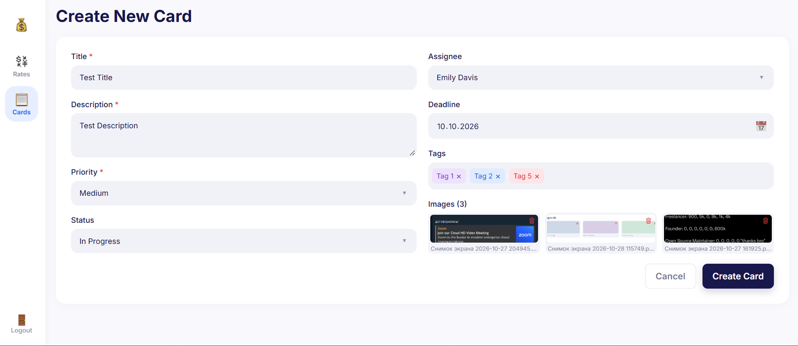
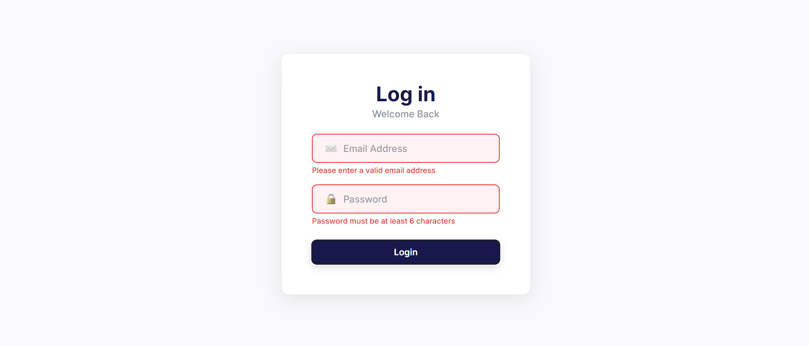

# Тестовое задание

## Общее описание

**Стек технологий:** React + Redux + TypeScript

**Деплой:** [https://noisekov.github.io/aezakmi/](https://noisekov.github.io/aezakmi/)

## Установка и запуск

1. Клонировать репозиторий:

   ```bash
   git clone https://github.com/noisekov/aezakmi.git
   ```

2. Перейти в директорию проекта:

   ```bash
   cd aezakmi
   ```

3. Установить зависимости:

   ```bash
   npm install
   ```

4. Запустить приложение в режиме разработки:

   ```bash
   npm run dev
   ```

5. Открыть адрес, указанный в терминале после запуска Vite.

## Сборка проекта

Для сборки приложения:

```bash
npm run build
```

## Используемые API

### Frankfurter API

**Документация:** [https://frankfurter.dev/](https://frankfurter.dev/)

**Базовый URL:** `https://api.frankfurter.dev/v2`

Frankfurter — открытый API для получения справочных курсов валют и исторических данных. API не требует регистрации или API-ключа.

В приложении используется для получения курсов валют, отображения изменений и построения графика динамики выбранной валюты относительно USD.

**Использование API в приложении:**

- Получение справочных курсов выбранных валют.
- Отображение предыдущего и текущего доступного курса.
- Расчёт абсолютного и процентного изменения между двумя последними доступными значениями.
- Получение исторических данных за неделю, месяц, три месяца, полгода или год.
- Построение графика динамики курса выбранной валюты.

Курсы являются справочными и обновляются ежедневно. Они не представляют собой банковские курсы покупки и продажи в реальном времени. Даты в таблице соответствуют датам публикации данных API.

## Структура проекта

- `src/components` — переиспользуемые UI-компоненты.
- `src/pages` — компоненты страниц приложения.
- `src/routes` — конфигурация маршрутов.
- `src/services` — работа с внешними API.
- `src/store` — Redux store и логика управления состоянием.
- `src/utils` — утилиты
- `src/types` — общие TypeScript-типы.

## Дополнительные библиотеки

- **flag-icons** — отображение флагов стран в таблице валют.

Флаги отображаются с помощью CSS-классов библиотеки, без использования emoji.

# Screenshots





